<p align="center">
  
</p>

> [!NOTE]
> **Reasonix Studio, continued** — a personal, continued fork of [DeepSeek-Reasonix](https://github.com/esengine/DeepSeek-Reasonix) on the `studio` (2.x) line.
>
> Upstream stopped at v2.61.0 on 2026-11-11. This repository takes that release as its base — one commit, that tree, unmodified — and carries its own work from there.

<p align="center">
  <strong>English</strong>
  &nbsp;·&nbsp;
  <a href="./README.zh-CN.md">简体中文</a>
  &nbsp;·&nbsp;
  <a href="./docs/GUIDE.md">Guide</a>
  &nbsp;·&nbsp;
  <a href="./docs/ACP.md">ACP</a>
  &nbsp;·&nbsp;
  <a href="./docs/EXTENSIONS.md">Extensions</a>
  &nbsp;·&nbsp;
  <a href="./docs/SPEC.md">Spec</a>
</p>

<br/>

## What this repository changes

The engine is kept as upstream left it. The work is in Reasonix Studio — the desktop app — and it is small and scoped:

- **The workbench.** Restored to 2.58's single-column shape after 2.61 split the body in two: the canvas is the body and the file tree is a column on the right, so a docked workbench is not left with an empty second panel. The tab strip then moved onto the window bar, sharing one hairline with the conversation below it.
- **Reaching a tab.** A picker at the head of the strip lists every open tab, so a tab hidden past the scroll or closed behind another is one click away instead of a scroll and a guess.
- **Tab titles follow the page.** A tab is named by the page's own title, re-read as the page renames itself — after load, on a script's rewrite, and on a route change that loads nothing. A page nobody handed to the agent used to stay named by its address.
- **Launch and layout details.** The project list starts folded on a cold launch, the launcher sits centred without its title, and the boot screen is a quiet one that follows the theme.
- **Small bug fixes.** Narrow defects in the desktop shell and the session store, fixed one at a time, each with the test that covers it.

Changes stay small and reviewable. Nothing here is a rewrite.

<p align="center">
  <a href="https://github.com/qiyuess/reasonix-studio/releases"></a>
  <a href="./LICENSE"></a>
  <a href="https://github.com/qiyuess/reasonix-studio/stargazers"></a>
</p>

<br/>

<p align="center"><strong>Open source · MIT · runs on your computer, model of your choice</strong></p>
<h3 align="center">An open-source coding agent for your terminal, desktop, browser and editor.</h3>
<p align="center">It reads your project, edits files and runs commands and tests. Have it ask before each step, or work on its own within limits you set. Files its edit tools changed can be rewound. New here? Start with the Studio desktop app.</p>

<br/>

## What it is

Reasonix is an open-source AI coding assistant. The program runs on your computer; the AI model is a service you configure, which receives what it reads. You describe a task in plain language; it reads code, edits files and runs commands and tests inside the project folder you choose, and shows you each step.

You pick the model: a DeepSeek preset is built in, any OpenAI-compatible service is one config entry, and you pay the model provider directly.

## What you get

- **Read, edit, run.** It reads code, edits files and runs tests and commands, all inside your project folder.
- **Permission levels.** Have it ask every time, or let everyday actions run on their own; your forbid rules always hold. To see the approach first, use plan mode: it starts work only once you approve.
- **Rewind.** A file is saved before it changes, so you can rewind by conversation turn without touching your git history. Only files its edit tools changed are covered, not what a shell command did.

## 30-second start

Download, add a model key, open a project. New here? Start with the Studio desktop app.

1. Download and install the desktop app, Reasonix Studio, from the [releases page](https://github.com/qiyuess/reasonix-studio/releases).
2. Open it and enter your model provider and key when asked.
3. Open your project folder and write what you want, for example "add retry on failure to the http client".
4. At the level you chose, it stops and asks before anything that needs your say-so. Allow it to continue, or refuse.

Prefer a terminal? Download the `reasonix` command-line tool, run `reasonix setup` to pick a model, then run `reasonix`. See [Install](#install) and [Quick start](#quick-start).

## Four ways to use it

- **Desktop app (Studio).** A graphical app; the best place to start.
- **Terminal.** A full-screen text interface; `reasonix run "task"` also works in scripts.
- **Browser.** `reasonix web` opens a web interface on your own machine.
- **Editor.** Install the extension in VS Code; other editors that support ACP (Agent Client Protocol, a common way for an editor to connect to an AI assistant) can connect to `reasonix acp`.

All four are the same program underneath. What follows is for advanced users and contributors.

## Use it from DeepSeek Harness

DeepSeek Harness (`dsh`) can hand a task to Reasonix as a subagent over ACP. This repository publishes a plugin index for it:

1. Run `reasonix setup` on the machine that runs `dsh`. In the DSH Web UI turn on Custom plugin markets (Plugins, More) and add this index in the Discover tab: `https://raw.githubusercontent.com/qiyuess/reasonix-studio/main/integrations/dsh-plugin/market-index.json`
2. Install "Reasonix subagent" from it.
3. Open the plugin's page and turn its switch on. While it is off the model has no `reasonix` tool and may run `reasonix -p` in its own shell, which looks like a delegation and is not one.

Setup details, the permission policy and limits are in [Using Reasonix from DeepSeek Harness](./docs/DSH.md).

## Versions

This repository continues from upstream's **v2.61.0** — the release at which upstream declared maintenance stopped. Releases move along this repository's own `studio` line, numbered from **2.70.0**; the jump is deliberate, so a build never sorts behind the official 2.61.0 the in-app updater still offers.

Releases are published from this repository's [releases page](https://github.com/qiyuess/reasonix-studio/releases). v2.61.0 remains the last upstream release, and `main-v2` — the 1.x line — is not part of this repository.

## Features

Technical highlights for advanced users.

- **Config-driven.** Providers, the agent, enabled tools, and plugins are all
  declared in `reasonix.toml`. No hardcoded models.
- **Multi-model & composable.** DeepSeek ships as a preset; any
  OpenAI-compatible endpoint is a config entry, not new code. Optionally run
  two models together (executor + planner) in separate, cache-stable sessions.
- **Plugin-driven.** MCP servers contribute tools, prompts, and resources;
  Extension Protocol v1 sidecars can also intercept runtime events, contribute
  Providers and structured UI, and ship versioned plugin packages.
- **Cache-aware context maintenance.** Startup injects a small stable environment
  summary, stale tool output is snipped/pruned before summary compaction, and the
  built-in tool schema contract is documented for regression review.
- **Zero-friction distribution.** `CGO_ENABLED=0` single binary; cross-compile
  to six targets with one command. The result is a fully self-contained static
  binary — nothing to install on the target machine beyond the binary itself.

## Install

The desktop app is Reasonix Studio; the CLI, Studio, and editor integrations all
run the same local Reasonix engine.

### Reasonix Studio

Download the package for your platform from the latest
[release](https://github.com/qiyuess/reasonix-studio/releases)
(tagged `studio-v2.7x.*`):

| Platform | Package | Architecture |
| --- | --- | --- |
| macOS | `.dmg` or `.zip` | Apple Silicon (`arm64`) / Intel (`amd64`) |
| Windows | Installer `-installer.exe` or portable `.zip` | x64 |
| Linux | `.deb`, `.rpm`, or `.AppImage` (download only) | x64 (`amd64`) / ARM64 (`arm64`, aarch64) |

The same release also carries the `reasonix` CLI as archives for
`darwin|linux|windows × amd64|arm64`.

### VS Code extension

The extension does not bundle the CLI; it starts your local `reasonix acp`
backend and adds native chat, editor context, tool-call approvals, model
selection, and workspace sessions. Install the CLI first.

- **VS Code:** [install from Visual Studio Marketplace](https://marketplace.visualstudio.com/items?itemName=SivanLiu.reasonix-agent)
- **VSCodium / Eclipse Theia:** [install from Open VSX Registry](https://open-vsx.org/extension/SivanLiu/reasonix-agent)
- **Extension ID:** `SivanLiu.reasonix-agent` · [source and usage guide](https://github.com/SivanCola/reasonix-vscode)

### Build from source

```sh
git clone https://github.com/qiyuess/reasonix-studio.git
cd reasonix-studio
```

#### CLI

The CLI build requires **Go 1.25+**. The module pins a `toolchain` directive;
keep `GOTOOLCHAIN=auto` so Go downloads the pinned toolchain, or install it.

```sh
make build      # -> bin/reasonix(.exe)
make cross      # -> dist/ (darwin|linux|windows × amd64|arm64)
```

#### Studio

Studio additionally requires **Node 24+ and pnpm 10**
(`npm install -g pnpm@10`) for the frontend.

```sh
make studio
```

See the [Studio build guide](desktop/README.md#prerequisites) for platform
webview dependencies and Linux build tags.

## Quick start

### Reasonix Studio

Install and launch Studio, then connect a provider and model in the app. No CLI
setup is needed.

### CLI / TUI

```sh
reasonix setup                      # configure a provider and model
reasonix                            # start an interactive session
reasonix run "implement the TODOs in main.go"
```

In an interactive session, run `/init` when you want Reasonix to create project
instructions.

For advanced CLI usage and configuration, see the **[CLI reference](./docs/CLI.md)**,
**[Guide](./docs/GUIDE.md)**, and
**[configuration paths](./docs/CONFIG_PATHS.md)**.

## Documentation

- **Getting started:** [Guide](./docs/GUIDE.md) · [CLI reference](./docs/CLI.md) ·
  [Configuration paths](./docs/CONFIG_PATHS.md) · [ACP editor integration](./docs/ACP.md) ·
  [Use from DeepSeek Harness](./docs/DSH.md)
- **Features & troubleshooting:** [Subagent profiles](./docs/SUBAGENT_PROFILES.md) ·
  [Context Engine v2](./docs/SESSION_MEMORY_RETRIEVAL.md) ·
  [Capability diagnostics](./docs/CAPABILITY_DIAGNOSTICS.md) ·
  [Recovery and updates](./docs/RECOVERY.md) ·
  [Checkpoints & rewind](./docs/CHECKPOINTS.md)
- **Agent presets:** [Session Agent compositions](./docs/AGENT_COMPOSITIONS.md)
- **Engineering & migration:** [Spec](./docs/SPEC.md) ·
  [Task contracts & pause policy](./docs/TASK_CONTRACT.md) ·
  [Tool contract](./docs/TOOL_CONTRACT.md) · [Moving from 1.x to 2.x](./docs/MIGRATING.md) ·
  [2.x roadmap](./docs/ROADMAP.md)
- **Extension development:** [Skills](./docs/SKILLS.md) · [Extensions](./docs/EXTENSIONS.md) ·
  [Plugin packages and Manifest v1](./docs/PLUGIN_PACKAGES.md) ·
  [Extension Protocol](./docs/EXTENSION_PROTOCOL.md) ·
  [Go SDK and starter](./sdk/go/README.md)

## Credits

Engine, desktop app and most of this documentation come from
[esengine/DeepSeek-Reasonix](https://github.com/esengine/DeepSeek-Reasonix), under the MIT license.
The logo and the intro video are by [**Bernardxu123**](https://github.com/Bernardxu123).

<p align="center">
  <sub>MIT — see <a href="./LICENSE">LICENSE</a></sub>
</p>
